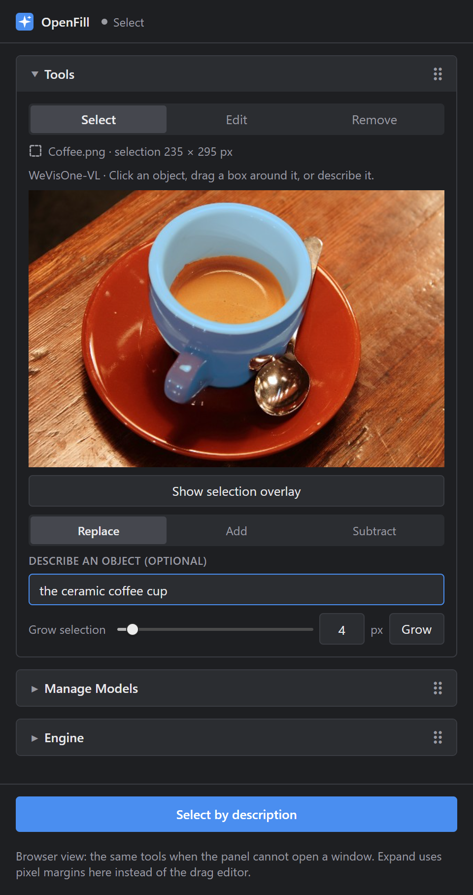
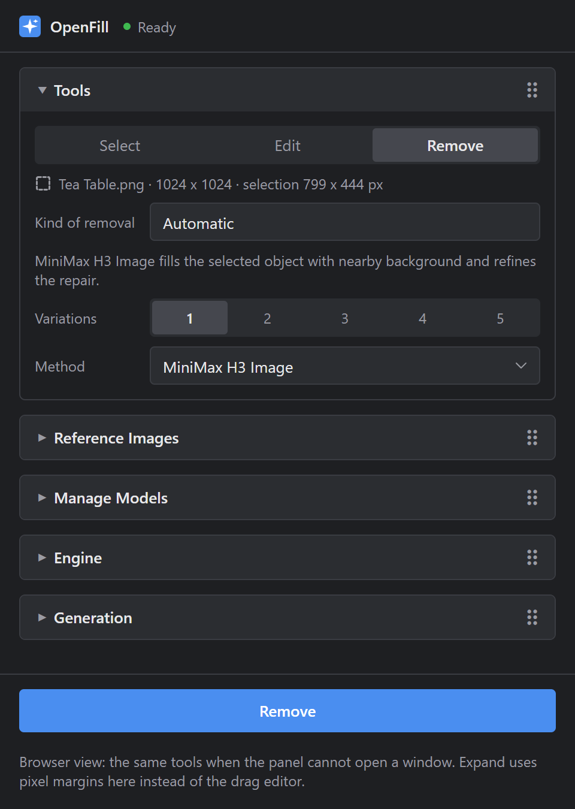
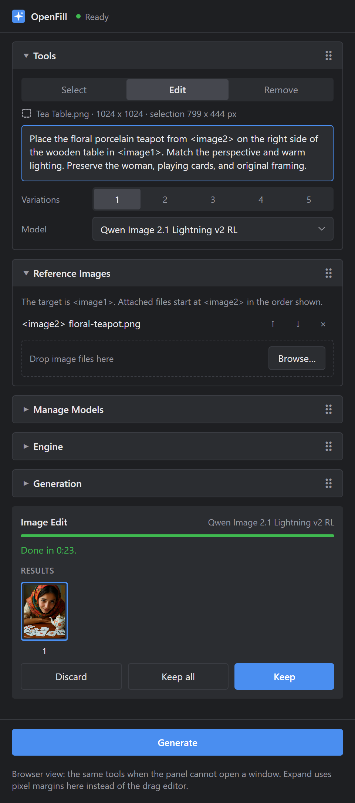
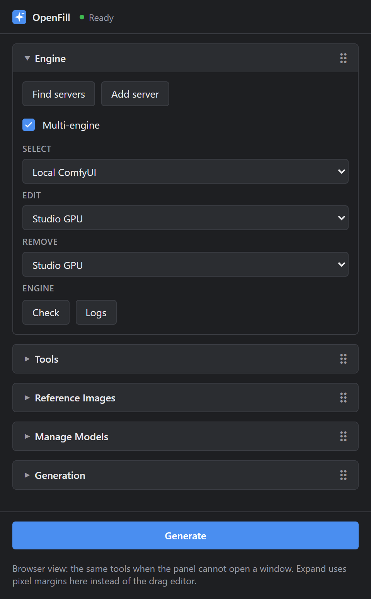

# OpenFill's Baby

 

*Select objects, edit with references, remove distractions, expand the canvas, and create images with ComfyUI.*

**[Download OpenFill's Baby](https://github.com/Omegadarling/OpenFill-s-Baby/releases/latest)** · [Setup and model guide](photocraft/README.md)

<table>
<tr><th>Select</th><th>Remove</th></tr>
<tr>
<td valign="top"></td>
<td valign="top"></td>
</tr>
</table>

**Select an object, refine its outline, then edit or remove it.** 
Current 0.20.3 browser UI, captured November 15, 2026 with saved example data. Click an image for full size. <a href="docs/screenshots/README.md#photocraft-0203">Screenshot details and credits</a>.

**OpenFill's Baby** extends [Beckett Harriman’s OpenFill](https://github.com/beckettharriman/openfill) for PhotoCraft. The original GIMP plug-in and its installation instructions are available upstream.

## What this fork adds

- **Select by click, box, or description.** WeVisOne-VL finds an object's outline. Replace, add to, or subtract from the selection, then refine it with PhotoCraft's own tools. **Show selection overlay** refreshes the mask in the preview. Drag the **Grow selection** slider or type an exact **1–500 px** amount; each Grow is one Undo step and works without ComfyUI. With **With its attached parts**, a selection also takes what the object holds or is attached to (a wheel, skis, a leash, a kite's string). [Selection setup](photocraft/README.md#select-an-object).
- **Remove without a prompt.** Select the object and a small background margin; with **With its shadow and reflection**, OpenFill finds the object's own shadow and reflection and removes them too. Under **Kind of removal → Automatic**, OpenFill makes two repairs with the methods rated best for a selection of that size (RORem, FLUX 3 Image Klein, Qwen Lightning, LaMa), adds Local's repair on plain surroundings, and runs with the settings those ratings were made with. Without those methods it prefers **MiniMax H3 Image**, or reads the surrounding colors, edges and texture and suggests an available method. Choose a scene or override **Method** yourself. Local background repair works offline; compatible servers can also offer LaMa, RORem, Qwen Lightning and FIBO Dev. Choose **1–5 variations** and compare the repairs on the canvas. [Removal guide](photocraft/README.md#remove-an-object).
- **Edit** with MiniMax H3 Image, MOSS AnyPaint, full Qwen Image 2.1 BF16, four-step Qwen Image 2.1 Lightning v2 RL, and compatible FIBO 2.0 Edit Turbo and Dev NVFP4 checkpoints on an existing ComfyUI server. MiniMax H3 Image and MOSS AnyPaint also appear as methods in **Remove** when their models are available. **Automatic** in Edit's Model menu makes two or three edits with the models that rated best together for that kind of edit, so you keep the better one without knowing which model suits it. [Automatic Edit](photocraft/README.md#automatic-edit).
- **Multiple reference images** for MiniMax H3 Image (up to four attachments), Qwen 2.1 and FIBO 2.0 (up to 15). Add and reorder references, then use their labels in the prompt. Drag image files in from Explorer on Windows or drop them into the browser panel.
- **Softer removal edges.** Remove preserves a feathered selection and blends the repair into a small margin of background. H3 refines a background-filled guide to match the surrounding lighting; on a smooth surface it can continue a narrow seam when matching segments are visible on both sides.
- **Automatic feathering** softens the mask inward so an edit blends into the original along the selection edge.
- **FIBO 2.0 context controls** give the model either the full image or an adjustable crop around the selection. The selection still controls where the edit appears. Optional boundary color matching helps blend it into the original.
- **One rearrangeable panel.** Expand or collapse sections for editing, references, models, engine settings, and generation. Drag the section grips to reorder them. OpenFill remembers your layout and which models you show in the dropdown. Generation changes apply to the next accepted job and are saved for later.
- **Compare more variations.** Click **Generate** again in Image Edit or Fill on the same document to add to the choices already shown. **Keep**, **Keep all**, and **Discard** sit below the thumbnails.
- **Find and remember your engines.** **Find servers** discovers running ComfyUI servers; **Add server** saves an HTTP(S) address or trusted SSH alias. All three tools share one engine by default. Enable **Multi-engine** to give Select, Edit and Remove their own servers. [Engine setup](photocraft/README.md#find-or-add-a-comfyui-server).

## Edit with references and choose where it runs

<table>
<tr><th>Reference-guided Edit</th><th>Engine assignments</th></tr>
<tr>
<td valign="top"></td>
<td valign="top"></td>
</tr>
<tr><td>The document is image 1; attachments follow in order. This example replays a saved Qwen Lightning edit using <a href="https://huggingface.co/lightx2v/Qwen-Image-2.1-Lightning-v2-RL#multi-reference-generation-1">LightX2V demo inputs</a>.</td><td>Example server names and assignments. Models and GPU work stay on the server selected for the tool.</td></tr>
</table>

Both the native panel beside PhotoCraft and the browser view provide Select, Edit, Remove, references, model visibility, engine routing and generation settings. Collapse or reorder sections to suit your workspace.

Watch the reference-edit walkthrough

This earlier walkthrough shows the reference workflow. The screenshots above show the current 0.20.3 controls.

## Fill, expand, and create

The managed engine also supports the original tools.

<table>
<tr><td><b>Fill with a prompt</b></td><td>Select, type "a red door with brass handles", Enter. The fill lands on a new layer with a soft mask.</td></tr>
<tr><td><b>Remove object</b></td><td>Select, press Remove. No prompt. It erases the selection at your image's own resolution.</td></tr>
<tr><td><b>Generative Expand</b></td><td>Drag the canvas edges outward or pick a ratio, and it paints the new border. The prompt is optional.</td></tr>
<tr><td><b>Create</b></td><td>A new image or a new layer from a prompt, sized to the selection if there is one.</td></tr>
</table>

Edits and removal results go on new layers, with Keep, Discard and Undo available. Your existing layers are never painted over. In PhotoCraft, open the panel from `Filter > Plug-ins > OpenFill`.

## Where generation runs

The managed engine runs ComfyUI locally for Fill, Remove, Expand, and Create. **Select** and the newer **Edit** and **Remove** models use a compatible ComfyUI server you run yourself, either on the PhotoCraft computer or another computer on your LAN. **Grow** and **Local background repair** run inside PhotoCraft without a GPU model.

Start ComfyUI on the server, then open **Engine → Find servers** in PhotoCraft. Choose a result, give it a name, and select it under **Shared engine**. Use **Add server** for a custom address or a trusted SSH alias such as `ssh://studio:8188`. Both panels remember your servers. Models for remote jobs stay on the selected server. [Find or add a ComfyUI server](photocraft/README.md#find-or-add-a-comfyui-server)

## Install

Install on Windows 10 or 11, Linux, or Apple Silicon macOS. For the standard tools, 8 GB of graphics memory covers many SDXL and FLUX configurations, and LaMa and SD 1.5 can use less. H3, Qwen 2.1 and FIBO require a compatible ComfyUI server and more memory. AI selection needs the optional WeVisOne-VL weights on its server. On Windows, the managed engine can download ComfyUI for NVIDIA or AMD cards. [Platform instructions](photocraft/README.md#what-you-need)

1. Install PhotoCraft. You can [reuse ComfyUI's Python](photocraft/README.md#use-comfyuis-python), or install Python from [python.org](https://www.python.org/downloads/) if you need it.
2. Download the `openfill-photocraft-*.zip` installer from the [fork’s latest release](https://github.com/Omegadarling/OpenFill-s-Baby/releases/latest). Unzip it and run **Install OpenFill for PhotoCraft.cmd** on Windows or `sh install.sh` on Linux or macOS.
3. Open **PhotoCraft with OpenFill**. For the standard tools, set up the managed engine and use **Manage Models** to install models. For H3, Qwen 2.1 or FIBO 2.0, follow the [existing ComfyUI setup](photocraft/README.md#edit-with-an-existing-comfyui). For AI selection, follow the [WeVisOne-VL setup](photocraft/README.md#select-an-object).

## Models

Install models on the computer running ComfyUI. The two engine modes support different workflows.

| Engine | Models |
| --- | --- |
| **Existing ComfyUI** for Select | WeVisOne-VL with the ComfyUI mask decoder; discovers compatible 2B/4B BF16 and INT8 encoders. |
| **Existing ComfyUI** for Edit | MiniMax H3 Image, Qwen Image 2.1 Full BF16 and four-step Lightning v2 RL, and FIBO 2.0 Edit Turbo and Dev Edit NVFP4. Existing-server SDXL editing requires a verified checkpoint entry; the public registry starts empty. |
| **Existing ComfyUI** for Remove | MiniMax H3 Image, Big-LaMa through ComfyUI-RMBG, RORem, Qwen Image 2.1 Lightning and FIBO Dev, when the required weights and nodes are present. Local background repair is also available without ComfyUI. |
| **Managed ComfyUI** for Fill, Remove, Expand, and Create | SDXL (including RealVisXL V5 and Juggernaut XL v9), SD 1.5 inpainting (including DreamShaper 8), FLUX.1 Fill, Qwen Image Edit 2511 GGUF, and removal models such as LaMa, MAT, and RORem. Available tools depend on the model. |

[Existing-server model files](photocraft/README.md#existing-server-models) · [Managed model catalog](photocraft/README.md#managed-engine-models)

The following timings are for the original managed tools, not H3 or the existing-server models:

| Job | Example model | Graphics memory | Time (RTX 4070 Laptop) |
|---|---|---|---|
| Remove object | LaMa (RORem and a FLUX eraser to compare) | 2 GB | about 5 s |
| Fast fill | DreamShaper 8 Inpainting | 4 GB | about 9 s |
| Quality fill | RealVisXL V5 with the Fooocus inpaint patch | 8 GB | 20 to 45 s |

Each model has its own license. MAT and the FLUX.1 Fill models are **non-commercial**. Details in [docs/models.md](docs/models.md).

## Status

Where it still falls short:

- **Original managed FLUX and Qwen fills, Expand and Create work at about 1024 px** and are scaled up, so on big images they come back softer. Dedicated removal models use their own working resolutions.
- **SD 1.5 often ignores the prompt** on flat areas and small selections. Pick an SDXL model.
- **FLUX on 8 GB is slow.**
- **Removal reconstructs a plausible background.** Hidden lettering, complex geometry and missing details may need manual repair. Select shadows and reflections the selection model does not find (a shadow that does not touch the object, a reflection in a mirror beside it) and inspect each result. H3 works near 4 megapixels and resizes to the selected crop; other models have their own working resolutions.

PhotoCraft changes are in the [companion changelog](photocraft/CHANGELOG.md).

## Where it came from

OpenFill started as a GIMP 3 port of [Torben Giesselmann's GIMP plug-in](https://github.com/thndrbrrr/gimp-stable-boy). The backend is [ComfyUI](https://github.com/comfyanonymous/ComfyUI). Acly's [comfyui-inpaint-nodes](https://github.com/Acly/comfyui-inpaint-nodes) do the inpainting, and his [krita-ai-diffusion](https://github.com/Acly/krita-ai-diffusion) was the reference for how to build the graphs and manage the server. OpenFill is not affiliated with PhotoCraft.

Open, as in open source and on your own machine. Fill, as in the thing everyone else rents you by the month.

## License

[Apache-2.0](LICENSE) © 2026 Beckett Harriman.
